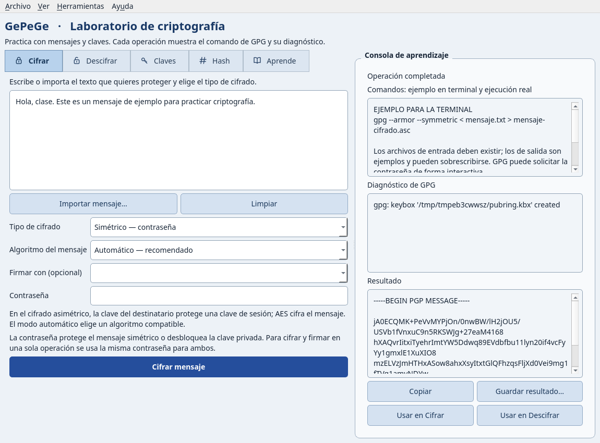

# GePeGe

GePeGe es una aplicación de escritorio para aprender a usar GnuPG (GPG). Su interfaz en castellano permite practicar el cifrado y la gestión de claves, y muestra tanto un ejemplo de comando para la terminal como el diagnóstico de GPG.



## Descarga e instalación

La última versión publicada está disponible en [GitHub Releases](https://github.com/k4liptu/GePeGe/releases). Para Linux x86-64, descarga el AppImage y dale permiso de ejecución:

```bash
chmod +x GePeGe-0.2a-x86_64.AppImage
./GePeGe-0.2a-x86_64.AppImage
```

La aplicación necesita **GnuPG** (`gpg`) instalado en el sistema. El AppImage no necesita Python instalado. Consulta las notas de cada release para conocer sus requisitos y comprobar su archivo SHA-256.

La [versión de prueba 0.2b](https://github.com/k4liptu/GePeGe/releases/tag/v0.2b) incorpora la publicación opcional de claves públicas y un instalador para Windows x86-64. El instalador incluye GnuPG y abre su instalación oficial cuando no lo encuentra. Requiere permisos de administrador; su uso interactivo en Windows está pendiente de más pruebas.

## Funciones

- Cifrar y descifrar textos y archivos mediante una contraseña o un par de claves OpenPGP, con salida ASCII (`.asc`) o binaria (`.gpg`).
- Firmar al cifrar y consultar el diagnóstico de verificación al descifrar.
- Generar claves, consultar el llavero, importar y exportar claves públicas, y borrar claves tras confirmación.
- Buscar claves en keys.openpgp.org. Desde la versión 0.2b también se puede publicar voluntariamente la clave pública recién generada.
- Calcular y comparar los hashes SHA-256, SHA-512 y SHA-1 de un archivo. SHA-1 se incluye para prácticas con sistemas antiguos.
- Consultar explicaciones y ejemplos de comandos GPG desde la aplicación.

## Uso básico

1. Para cifrado asimétrico, crea un par de claves o importa la clave pública del destinatario desde **Almacén de claves**. Comprueba siempre su huella por un canal independiente.
2. En **Cifrar**, escribe un mensaje o importa un archivo, elige el destinatario y, opcionalmente, una clave para firmar. Para cifrado simétrico, selecciona ese modo e introduce una contraseña.
3. Copia o guarda el resultado y compártelo. Comunica las contraseñas por un canal independiente.
4. En **Descifrar**, pega o importa el mensaje e introduce la contraseña del mensaje o de tu clave privada. Consulta el diagnóstico para conocer el resultado y, si procede, la verificación de la firma.

Una firma válida indica que corresponde a una clave; no demuestra por sí sola la identidad de su propietario. Si GPG no confía plenamente en una clave importada, GePeGe permite confirmar su uso para un mensaje después de comprobar la huella, sin cambiar la confianza guardada en el llavero.

## Consideraciones y límites

GePeGe utiliza el llavero GPG del usuario actual. La eliminación de una clave con parte privada elimina ambas partes y sus subclaves tras dos confirmaciones. Conserva una copia de seguridad de tus claves privadas.

Los archivos se cargan en memoria. Los resultados reconocidos como texto UTF-8 se muestran en el editor y se guardan como texto; los demás se guardan como datos binarios. Las claves importadas deben estar en formato ASCII. Al cifrar simétricamente y firmar en una sola operación se utiliza la misma contraseña para ambas funciones.

La búsqueda y la publicación de claves requieren conexión a Internet. Desde la versión 0.2b, la publicación envía únicamente la clave pública a keys.openpgp.org tras solicitar confirmación. Si la clave incluye un correo, el servicio puede enviar un enlace de verificación para habilitar su búsqueda por esa dirección.

La consola muestra un ejemplo didáctico y, después, la ejecución real. Los nombres y redirecciones del ejemplo son orientativos y pueden sobrescribir archivos si se ejecutan sin revisarlos. GePeGe no incluye la contraseña en los argumentos del comando mostrado.

## Ejecutar desde el código

En Linux, instala Python 3.10 o superior, GnuPG 2.2 o superior y las bibliotecas gráficas necesarias para Qt. Para las funciones en línea se necesitan los certificados de confianza del sistema.

```bash
python3 -m venv .venv
.venv/bin/pip install -r requirements.txt
.venv/bin/python app.py
```

El código de desarrollo busca GnuPG también en las ubicaciones habituales de Gpg4win en Windows. Allí se necesita instalar [Gpg4win](https://www.gpg4win.org/download.html) por separado. El script `packaging/windows/Instalar-Gpg4win.ps1` ofrece instalarlo mediante winget tras pedir confirmación.

## Pruebas y compilación

Las pruebas de integración crean llaveros temporales y no modifican el llavero personal:

```bash
.venv/bin/python -m unittest discover -s tests -v
```

GitHub Actions ejecuta las comprobaciones de Linux. Las pruebas de integración y de la interfaz también se ejecutan en Windows; aún falta ampliar la validación interactiva del instalador.

Para compilar el AppImage se necesitan las dependencias de `requirements-build.txt` y `appimagetool` en el `PATH`:

```bash
.venv/bin/pip install -r requirements-build.txt
./packaging/build-appimage.sh
```

Para una mayor compatibilidad, `packaging/build-ubuntu22-container.sh` prepara el AppImage dentro de Ubuntu 22.04. El script espera el código en `/src`, la carpeta de salida en `/out`, y `appimagetool` y su runtime en `/tools`. El paquete resultante sigue necesitando GnuPG en el sistema.

## Licencia

GePeGe se distribuye bajo la [GNU General Public License, versión 3](LICENSE). Las dependencias tienen sus propias licencias; consulta [DEPENDENCIAS.md](DEPENDENCIAS.md) para conocerlas.
